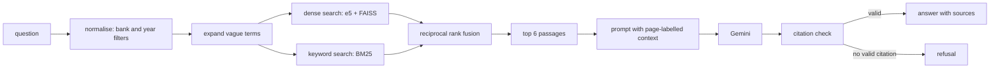

# Architecture

The system answers Indonesian questions about ten annual reports (five banks, 2023 and
2024) and cites the report and PDF page behind every claim. It is a two-stage pipeline:
an offline index build, and an online request path that retrieves passages and asks a
language model to answer only from them.

## Request flow



The interface is a single Streamlit page. `answer_question(question, banks)` is the
only entry point it uses; everything below that boundary is plain Python that can be
tested without a browser.

## Index build

```
PDF ──► PyMuPDF page text ──► token-aware chunks ──► e5-small ──► FAISS
                                      │
                                      └──────────► chunks.jsonl
```

- Text is extracted per page. A chunk is built from one page only, so a citation can
  never point at a page that does not contain the quoted text. Pages shorter than 30
  tokens are dropped because they carry no retrievable content.
- Chunks target 400–450 e5 tokens with 12% overlap. The overlap keeps a sentence that
  straddles a boundary retrievable from both sides.
- Embeddings come from `intfloat/multilingual-e5-small` (384 dimensions) through
  fastembed and ONNX Runtime. No PyTorch, no GPU. E5 expects `passage:` and `query:`
  prefixes, which `rag/embeddings.py` applies.
- Vectors are normalised, so inner product equals cosine similarity. One FAISS index
  per bank lets a filtered question search only the relevant vectors.

The output is `index/chunks.jsonl` (passages and metadata), `index/faiss/<bank>.faiss`,
and `index/manifest.json` (document checksums, chunk counts, build time).

## Retrieval

Both branches run over the same filtered candidate set:

- **Dense** handles paraphrase: "laba bersih" can match "net profit attributable to
  owners".
- **BM25** handles exact domain terms: `NPL`, `CAR`, `BOPO`, `NPF`.
- **Reciprocal rank fusion** combines the two ranked lists by position rather than raw
  score. Cosine similarity and BM25 scores are not comparable, and RRF avoids having to
  calibrate them against each other.

Two query transformations run before retrieval:

1. Vague terms are expanded with domain vocabulary. "Apa risiko utama?" becomes a
   query that also contains *risiko kredit, risiko pasar, risiko likuiditas, ...*, which
   is the language of the risk sections. Expansion applies to both branches: on the
   dense branch alone it does not surface the risk-management pages.
2. When the bank filter actually narrows the selection, the bank's name is removed from
   the query. "Bagaimana NPL Bank Mandiri?" with only BMRI selected becomes "Bagaimana
   NPL?", which stops the name from competing with the passage that holds the figure.

A year named in the question narrows the candidate pool to that year, so a 2023
question cannot be answered from a 2024 report.

## Answer generation

The six highest-ranked passages are rendered as page-labelled blocks and sent to
Gemini with three rules: answer only from the blocks, cite every figure as
`[DOC, hlm. PAGE]`, and reply with a fixed refusal sentence when the blocks do not
contain the answer.

The reply is then validated, not trusted:

- Every citation is matched against the passages that were actually retrieved. A
  citation to a page outside the context is removed.
- An answer whose citations all disappear, or that begins with the refusal phrase, is
  replaced by the refusal text and returned with no sources.
- Whitespace and punctuation left behind by removed citations are cleaned up.

Generation runs at temperature 0. Reading a figure out of a passage has one right
answer, and at 0.2 the same prompt refused roughly one question in four that it
answered on the next attempt.

There is no relevance-score threshold. The fused score does not separate answerable
from unanswerable questions: an out-of-scope question scored as high as the best
in-scope one. Refusal is enforced by the prompt and the citation check instead.

## Deployment

The index is about 80 MB, which is too large for git and too slow to rebuild on a
hosted machine (the PDFs are not redistributed). It is published as the `index-v1`
release asset. On first start the app downloads it, verifies a SHA-256 checksum, and
unpacks it into `index/`. A failed download shows a setup message rather than a stack
trace.

Settings come from environment variables locally and from `st.secrets` on Streamlit
Community Cloud. `rag/config.py` checks the environment first, so the same code runs
in both places.

## Decisions

| Decision | Alternative | Why |
|---|---|---|
| Page-bounded chunks | Fixed-size sliding window | Citations stay truthful; a page never cites text from its neighbour |
| e5-small via ONNX | Larger model via PyTorch | CPU-only hosting, no GPU, no heavy PyTorch install |
| One FAISS index per bank | Single index with metadata filter | Filtered search reads less and stays exact |
| Reciprocal rank fusion | Weighted score blend | No calibration between cosine and BM25 scores |
| Prompt and citation check for refusal | Score threshold | Fused scores overlap between answerable and unanswerable questions |
| Temperature 0 | Default sampling | Extraction has one correct answer; sampling caused random refusals |
| Index as release asset | Commit to git, or rebuild on deploy | Keeps the repository small and the deploy fast |
| `MIN_RELEVANCE_SCORE=0` | Tuned cutoff | Measured on real questions and found not to separate the classes |

## Failure modes

- **Chart pages.** A page that is mostly a chart can extract as a run of numbers
  without their headers. The model may then attach a figure to the wrong period.
- **Wording mismatch.** If the question and the passage share no vocabulary, neither
  branch retrieves the page, and the app refuses a question it could have answered.
- **Free-tier quota.** Gemini's free tier allows 500 requests per day and roughly 15
  per minute. The app throttles one request every three seconds per session and caches
  repeated questions, but a busy demo can still reach the daily cap.
